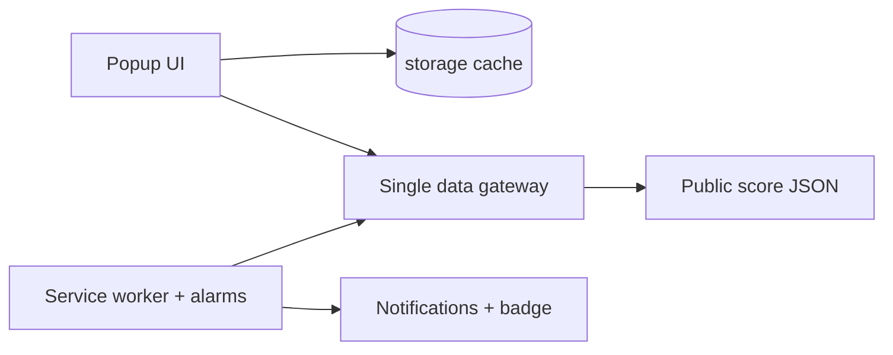

# SkorFire Live Football — showcase

Live scores, today's fixtures, league tables and goal notifications from the browser toolbar. Free, no account, no ads, no tracking. Chrome, Edge and Firefox; 19 languages.

**Install:** [Chrome Web Store](https://chromewebstore.google.com/detail/apallmfeiokillgdbpedodafkgampneh) · [Website](https://skynonlabs.com/browser-extensions/skorfire/) · [Privacy](https://skynonlabs.com/browser-extensions/skorfire/privacy/) · [Türkçe](README.tr.md)

> This repository is a showcase. The source code is private. Not affiliated with ESPN.

| | |
|---|---|
|  |  |
|  |  |

## Architecture

- **No server, no dependencies, no build step.** Plain HTML, CSS and JavaScript on Manifest V3; running cost is zero.
- **Minimal permissions:** storage, alarms, optional notifications, one API host. No content scripts.
- **Adaptive cache:** 30 s around live matches, 5 min otherwise.

## Engineering details

- **One gateway for the data source.** Every request goes through one module, so an undocumented API change touches one file.
- **"If unsure, don't show it."** Match state is mapped from the exact status code; postponed, suspended and cancelled games are never shown as full time.
- **Bugs other apps ship, avoided by design:** wrong competition IDs (verified against the live API), old finals shown as today's results (36-hour window), silent 100-match truncation (explicit limit + warning), matches lost at midnight (yesterday, today and tomorrow fetched separately).
- **Offline unit tests** on Node's built-in runner, including locale completeness and version parity checks.
- **19 locales**, every visible string localized; light and dark theme.

© 2026 Skynon Labs Ltd. All rights reserved. · hello@skynonlabs.com
