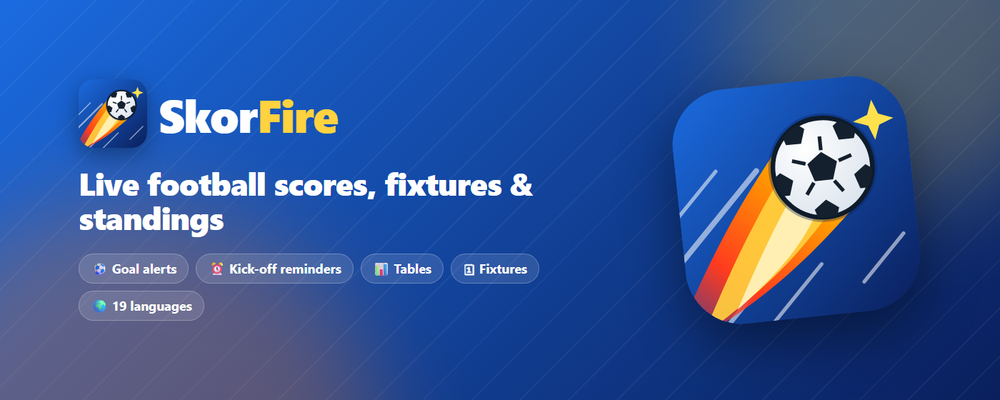
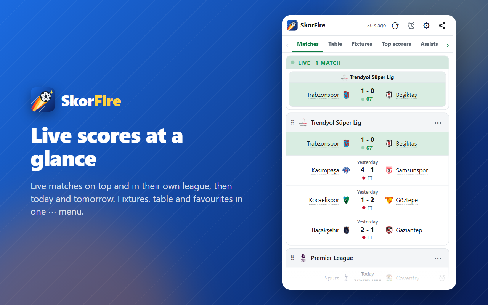
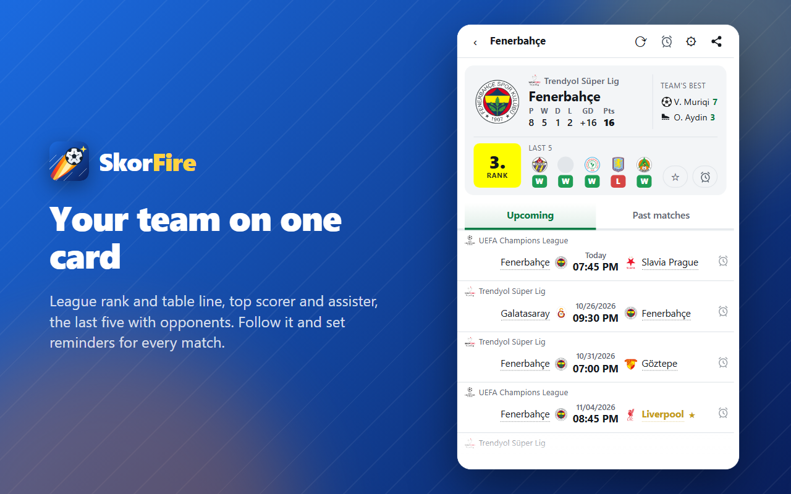
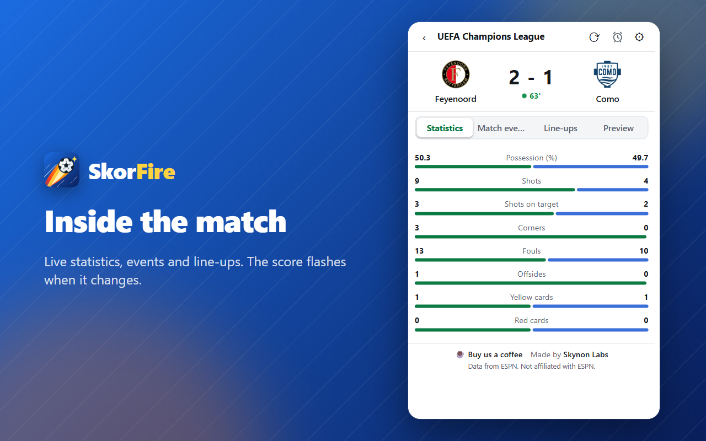
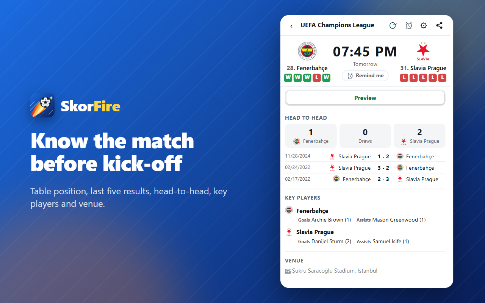
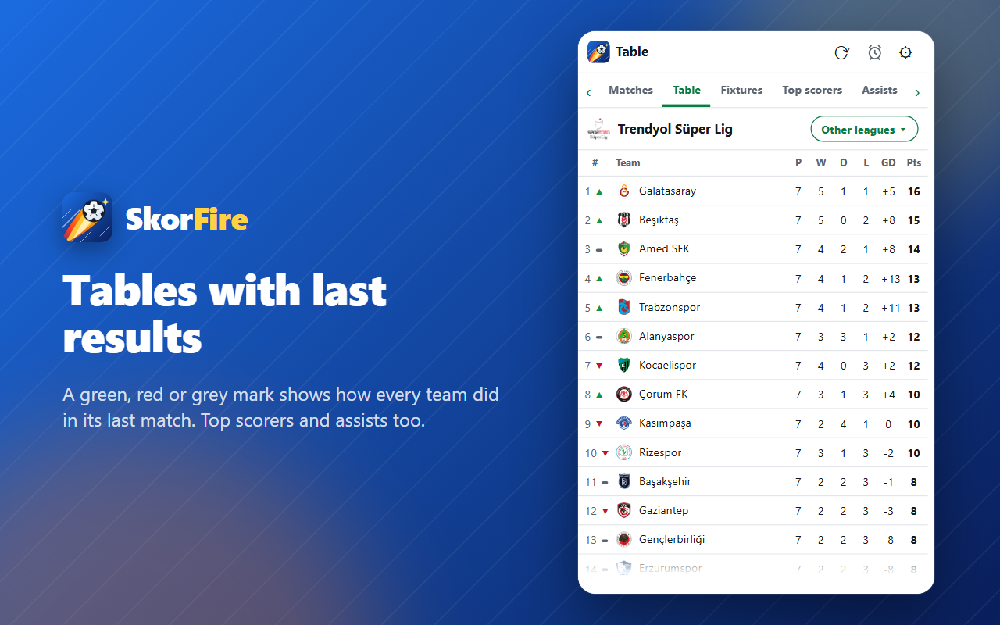
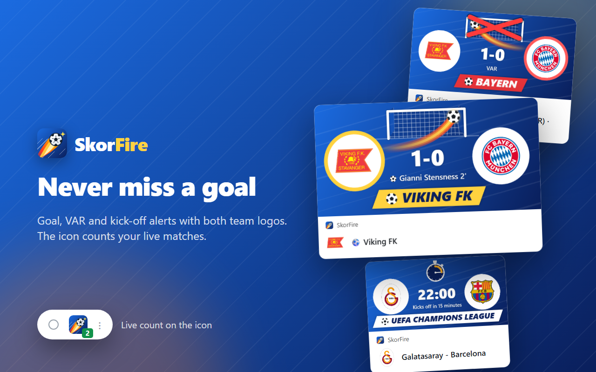
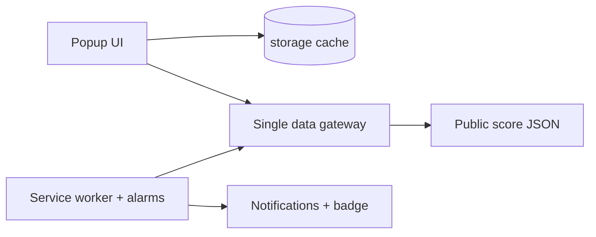

# SkorFire Live Football — showcase

Live scores, today's fixtures, league tables and goal notifications from the browser toolbar. Free, no account, no ads, no tracking. Chrome, Edge and Firefox (desktop and Android); 19 languages.

**Install:** [Chrome Web Store](https://chromewebstore.google.com/detail/apallmfeiokillgdbpedodafkgampneh) · [Microsoft Edge](https://microsoftedge.microsoft.com/addons/detail/neljlflmnlamhdkdgdpokgiaieplmmia) · [Firefox](https://addons.mozilla.org/firefox/addon/skorfire-live-football/) · [Website](https://skynonlabs.com/browser-extensions/skorfire/) · [Privacy](https://skynonlabs.com/browser-extensions/skorfire/privacy/) · [Türkçe](README.tr.md)

> This repository is a showcase. The source code is private. Not affiliated with ESPN.

| | |
|---|---|
|  |  |
|  |  |
|  |  |

## New in 2.9.0

Rolling out through store review (October 2026).

- **League rank on the team card:** the team's position sits under its logo in the team's own colour, next to the last 5 results; tap it to open the table.

## 2.8.1

- **Team card:** league and table line (P W D L GD Pts), the team's top scorer and assister, last 5 results with opponent logos.
- **Share menu:** WhatsApp, X, Facebook, Telegram, Reddit, LinkedIn, email or copy link.
- **Live block:** "Live · N matches" header and a clearer green; live matches also stay in their own league card.
- **League header ⋯ menu:** fixtures, table, favourite and remove from list in one place.
- **Last 5 boxes open that match;** hovering shows the date.
- **Firefox for Android** (Firefox 142 or later).

## Earlier releases

- **2.6 — Loading screen everywhere:** standings, top scorers, fixtures, match and team views show the animated logo loader; a "⟳ Refresh" button appears under it after a few seconds to reload by hand.
- **2.5 — Test notification:** a "📣 Test notification" link under each notification switch in Settings sends a sample goal, match-started or reminder notification, so you can check your system settings before a real match.
- **Clickable team names:** a faint dotted underline (solid green on hover) shows that a team name opens the team page.
- **Followed teams** stand out in matte gold, with the star on the outer side of the team.
- **Cleaner notifications:** the image "match started" notification now shows just the match name.

## Architecture

- **No server, no dependencies, no build step.** Plain HTML, CSS and JavaScript on Manifest V3; running cost is zero.
- **Minimal permissions:** storage, alarms, optional notifications, one API host. No content scripts.
- **Adaptive cache:** 30 s around live matches, 5 min otherwise. A list older than 30 min is never shown on open; an animated logo loading screen waits for fresh data instead.

## Engineering details

- **One gateway for the data source.** Every request goes through one module, so an undocumented API change touches one file.
- **"If unsure, don't show it."** Match state is mapped from the exact status code; postponed, suspended and cancelled games are never shown as full time.
- **Bugs other apps ship, avoided by design:** wrong competition IDs (verified against the live API), old finals shown as today's results (36-hour window), silent 100-match truncation (explicit limit + warning), matches lost at midnight (yesterday, today and tomorrow fetched separately).
- **Offline unit tests** on Node's built-in runner, including locale completeness and version parity checks.
- **19 locales**, every visible string localized; light and dark theme.

© 2026 Skynon Labs Ltd. All rights reserved. · hello@skynonlabs.com
