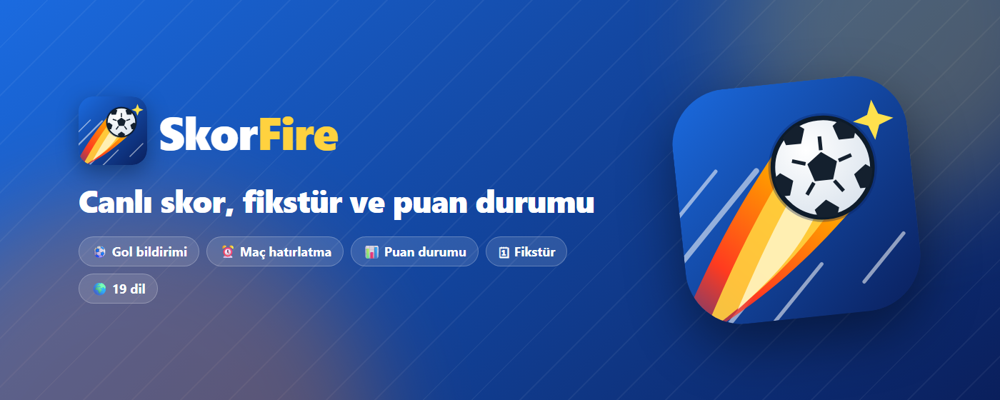
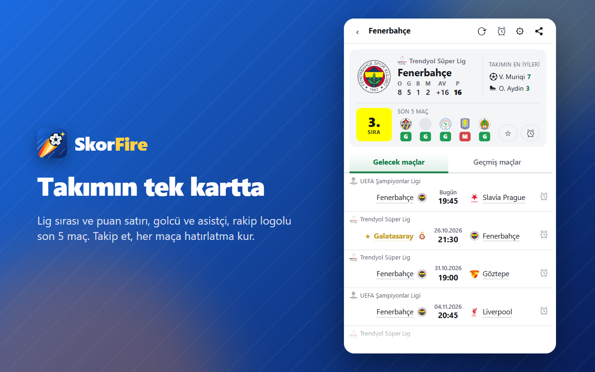

# SkorFire Live Football — vitrin

Canlı skor, günün maçları, puan durumu ve gol bildirimi; tarayıcı araç çubuğunda. Ücretsiz, hesapsız, reklamsız, izleyicisiz. Chrome, Edge, Firefox (masaüstü ve Android); 19 dil.

**Kurulum:** [Chrome Web Store](https://chromewebstore.google.com/detail/apallmfeiokillgdbpedodafkgampneh) · [Microsoft Edge](https://microsoftedge.microsoft.com/addons/detail/neljlflmnlamhdkdgdpokgiaieplmmia) · [Firefox](https://addons.mozilla.org/firefox/addon/skorfire-live-football/) · [Web sitesi](https://skynonlabs.com/browser-extensions/skorfire/)

> Bu repo bir vitrindir; kaynak kod özeldir. ESPN ile bağlantılı değildir.

## 2.9.0'da yeni

- **Takım kartında lig sırası:** takımın sırası logosunun altında, kendi renginde, son 5 maçın yanında; basınca puan durumu açılır.

## 2.8.1

- **Takım kartı:** lig ve puan tablosu satırı (O G B M AV P), takımın golcüsü ve asistçisi, rakip logolu son 5 maç.
- **Paylaş menüsü:** WhatsApp, X, Facebook, Telegram, Reddit, LinkedIn, e-posta veya bağlantıyı kopyala.
- **Canlı bölüm:** "Canlı · N maç" başlığı ve daha belirgin yeşil; canlı maçlar kendi lig kartında da görünür.
- **Lig başlığında ⋯ menüsü:** fikstür, puan durumu, favori ve listeden kaldır tek yerde.
- **Son 5 kutuları o maçı açar;** üzerine gelince tarih görünür.
- **Android için Firefox** (Firefox 142 ve üstü).

**Öne çıkan çözümler:** sunucusuz ve bağımlılıksız Manifest V3 · tüm veri tek modülden geçer · durumu belirsiz maç asla "bitti" gösterilmez · lig kimlikleri canlı API'ye karşı doğrulanır · gece yarısı kaybolan maç yok (dün/bugün/yarın ayrı istek) · çevrimdışı testler.

**Önceki sürümler:**

- **2.6 — Her yerde yükleme ekranı:** puan durumu, gol krallığı, fikstür, maç ve takım sayfaları logolu yükleme ekranını gösterir; birkaç saniye sonra altında beliren "⟳ Yenile" düğmesiyle elle yeniden yüklenir.
- **2.5 — Test bildirimi:** Ayarlar'da her bildirim anahtarının altındaki "📣 Test bildirimi" bağlantısı örnek bir gol, maç başladı veya hatırlatma bildirimi gönderir; gerçek maçtan önce sistem ayarlarınızı kontrol edebilirsiniz.
- **Tıklanabilir takım adları:** silik noktalı alt çizgi (üzerine gelince düz yeşil) takım adının takım sayfasını açtığını gösterir.
- **Takip edilen takımlar** mat altın renkle öne çıkar; yıldız takımın dış tarafındadır.
- **Sade bildirimler:** görselli "maç başladı" bildirimi artık yalnızca maç adını gösterir.

Mimari ve ekran görüntüleri: [README.md](README.md) · © 2026 Skynon Labs Ltd. Tüm hakları saklıdır.
